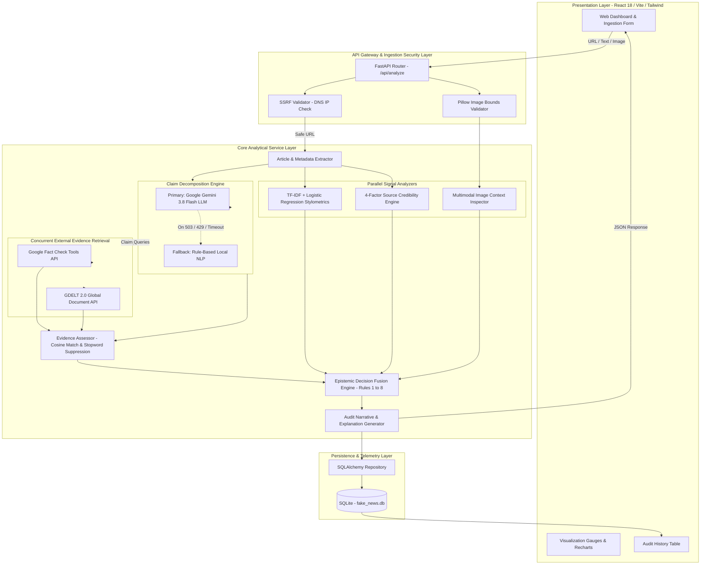
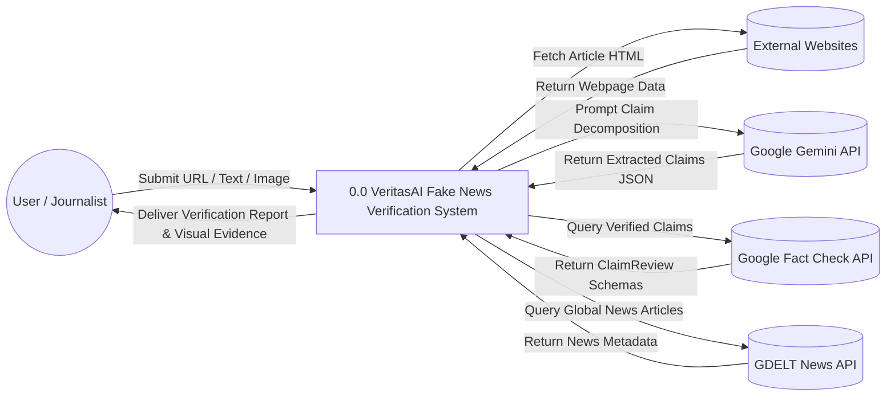
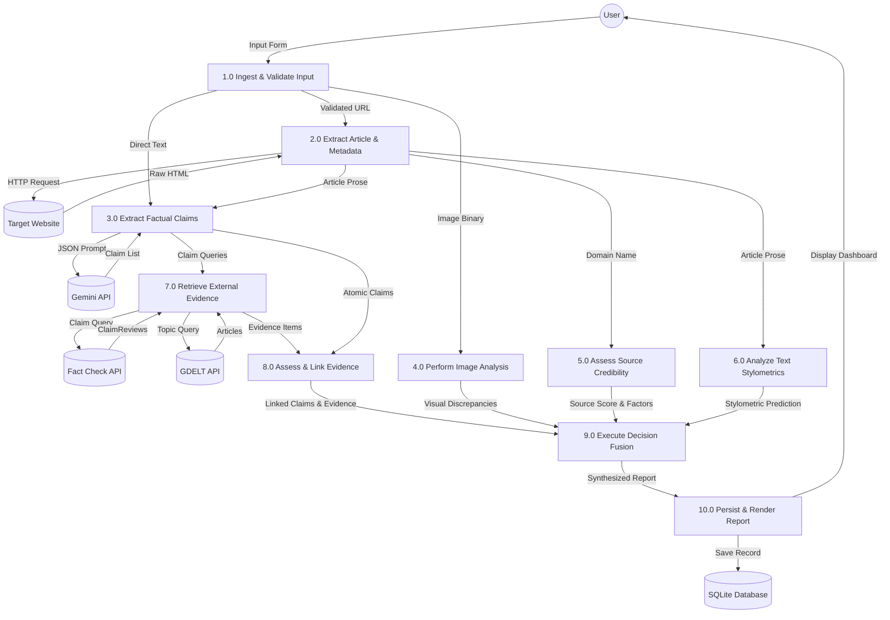
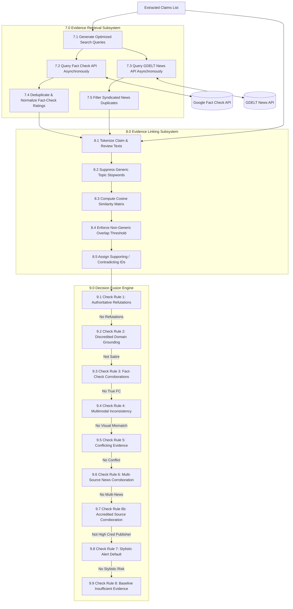
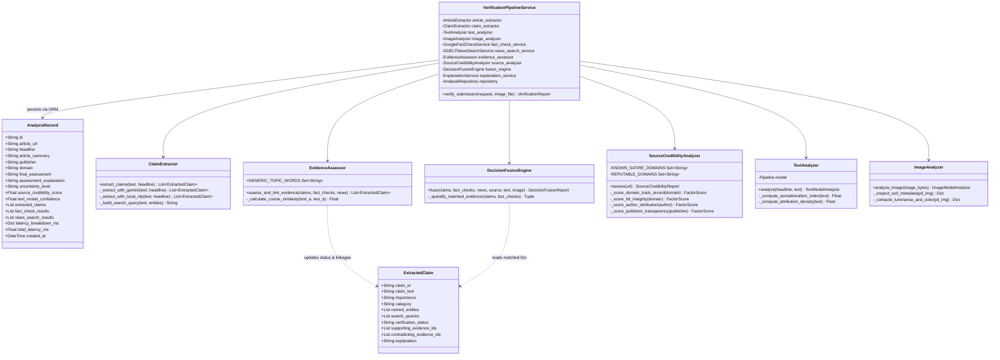
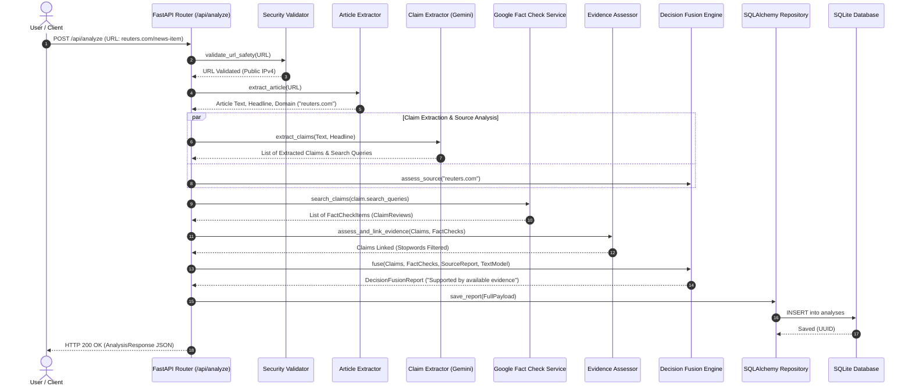
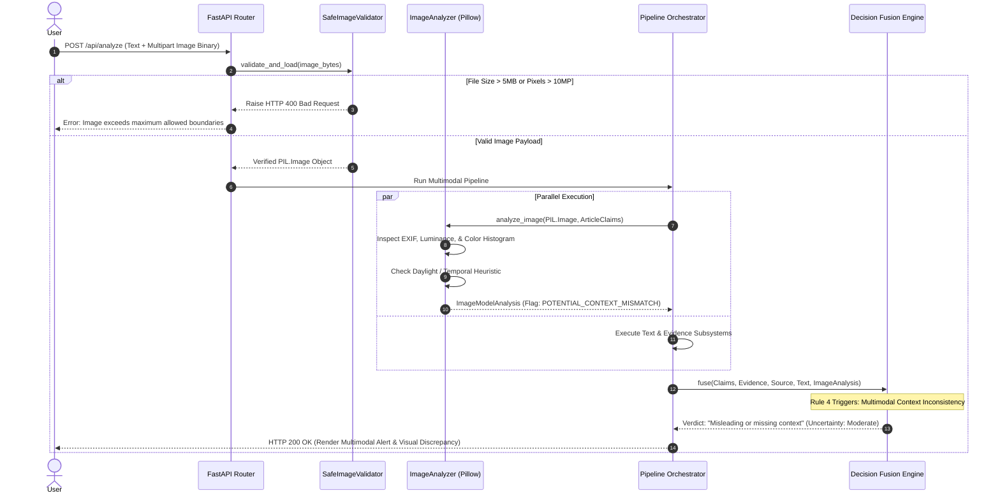
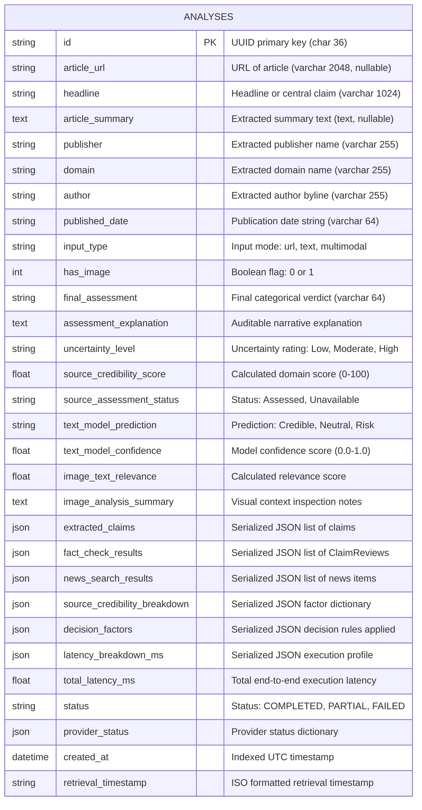

# VERITASAI – CONSOLIDATED MERMAID DIAGRAM SOURCE CODE

This document aggregates the complete, valid Mermaid diagram source code for all eleven architectural, data flow, sequence, and entity-relationship figures created for the B.Tech Project-I report. These code snippets can be copied directly into Mermaid Live Editor (`mermaid.live`), GitHub Markdown, or documentation build tools to render high-resolution PNG/SVG vector diagrams.

---

## Figure 4.1: VeritasAI Multi-Tier Pipeline Architecture Diagram



---

## Figure 4.2: Data Flow Diagram Level 0 (Context Diagram)



---

## Figure 4.3: Data Flow Diagram Level 1 (Pipeline Decomposition)



---

## Figure 4.4: Data Flow Diagram Level 2 (Evidence Retrieval & Fusion Subsystem)



---

## Figure 4.5: System Use Case Diagram

```mermaid
graph LR
    User((Journalist / User))
    Admin((System Auditor))
    FactCheckActor((Google Fact Check API))
    GeminiActor((Google Gemini LLM))
    GDELTActor((GDELT 2.0 API))

    subgraph VeritasAI_Platform [VeritasAI Platform Boundary]
        UC1[Submit Article URL for Verification]
        UC2[Submit Raw News Text / Claim]
        UC3[Upload Paired Article Image]
        UC4[View Claim-by-Claim Evidence Breakdown]
        UC5[Inspect Source Credibility Breakdown]
        UC6[View Execution Latency Profile]
        UC7[Browse & Filter Verification History]
        UC8[Delete Past Verification Record]
        UC9[Inspect Provider Health & Service Status]
        UC10[Decompose Factual Claims]
        UC11[Retrieve External Fact-Checks]
        UC12[Query Global News Coverage]
        UC13[Synthesize Epistemic Verdict]
    end

    User --> UC1
    User --> UC2
    User --> UC3
    User --> UC4
    User --> UC5
    User --> UC6
    User --> UC7
    User --> UC8

    Admin --> UC7
    Admin --> UC8
    Admin --> UC9

    UC1 ..> UC10 : <<include>>
    UC2 ..> UC10 : <<include>>
    UC10 <--> GeminiActor
    
    UC1 ..> UC11 : <<include>>
    UC11 <--> FactCheckActor

    UC1 ..> UC12 : <<include>>
    UC12 <--> GDELTActor

    UC1 ..> UC13 : <<include>>
    UC13 ..> UC4 : <<manifests>>
```

---

## Figure 4.6: Unified Backend & Frontend Class Diagram



---

## Figure 4.7: Sequence Diagram — Primary Live Fact-Checking Verification Workflow



---

## Figure 4.8: Sequence Diagram — Multimodal Image Submission & Context Consistency Workflow



---

## Figure 4.9: Sequence Diagram — Graceful Degradation & Provider Fallback Workflow

```mermaid
sequenceDiagram
    autonumber
    actor User as User
    participant Pipe as Pipeline Orchestrator
    participant Gemini as Gemini API Client
    participant LocalNLP as Rule-Based Local NLP Extractor
    participant GDELT as GDELT 2.0 API Client
    participant Fusion as Decision Fusion Engine

    User->>Pipe: Analyze Article Submission
    Pipe->>Gemini: POST /models/gemini-3.8-flash:generateContent (Timeout: 5.0s)
    
    alt Gemini Returns HTTP 503 (Overloaded) or HTTP 429 (Quota Exceeded)
        Gemini-->>Pipe: HTTP 503 / 429 Error
        Note over Pipe: Automated Fallback Triggered Instantly
        Pipe->>LocalNLP: _extract_with_local_nlp(Text, Headline)
        LocalNLP-->>Pipe: Return Extracted Claims & Entity Queries (0.5ms)
    else Gemini Network Timeout (5.0s elapsed)
        Pipe->>LocalNLP: _extract_with_local_nlp(Text, Headline)
        LocalNLP-->>Pipe: Return Extracted Claims & Entity Queries
    end

    Pipe->>GDELT: search_news(Queries) (Timeout: 4.0s)
    alt GDELT Returns HTTP 429 or Times Out
        GDELT-->>Pipe: Timeout / Rate Limit Detected
        Note over Pipe: Abort GDELT cleanly; return empty list []
    end

    Pipe->>Fusion: fuse(Claims, AvailableEvidence, Source, Text)
    Fusion-->>Pipe: Synthesized Verdict without Pipeline Interruption
    Pipe-->>User: HTTP 200 OK (Status: COMPLETED with Fallback Notes)
```

---

## Figure 4.10: Entity-Relationship Database Schema Diagram



---

## Figure 4.11: Algorithmic Decision Fusion Flowchart

```mermaid
flowchart TD
    Start([Start: Ingest Linked Claims, Evidence, Source, Text, Image]) --> LinkCheck{Were Claims Assessed by Pipeline?}
    
    LinkCheck -- Yes --> FilterMatched[Filter Fact-Checks Matched to Claim IDs via Evidence Assessor]
    LinkCheck -- No --> RawCount[Count Raw Fact-Check Verdicts - Standalone Mode]
    
    FilterMatched --> Rule1{Rule 1: Are Matched False/Mixed Fact-Checks > 0?}
    RawCount --> Rule1
    
    Rule1 -- Yes --> VerdictContradicted["Final Assessment: Contradicted by available evidence<br/>Uncertainty: Low<br/>Rule 1 Applied"]
    
    Rule1 -- No --> Rule2{Rule 2: Is Source Score <= 20.0 (Known Satire / Conspiracy)?}
    Rule2 -- Yes --> VerdictSatire["Final Assessment: Misleading or missing context<br/>Uncertainty: Low<br/>Rule 2 Applied"]
    
    Rule2 -- No --> Rule3{Rule 3: Are Matched True Fact-Checks > 0 AND Contradictions == 0?}
    Rule3 -- Yes --> VerdictSupportedFC["Final Assessment: Supported by available evidence<br/>Uncertainty: Low<br/>Rule 3 Applied"]
    
    Rule3 -- No --> Rule4{Rule 4: Is Image Flagged for Context Mismatch?}
    Rule4 -- Yes --> VerdictImageMismatch["Final Assessment: Misleading or missing context<br/>Uncertainty: Moderate<br/>Rule 4 Applied"]
    
    Rule4 -- No --> Rule5{Rule 5: Are Supporting Evidence > 0 AND Contradicting Evidence > 0?}
    Rule5 -- Yes --> VerdictConflict["Final Assessment: Conflicting evidence<br/>Uncertainty: Moderate<br/>Rule 5 Applied"]
    
    Rule5 -- No --> Rule6{Rule 6: Are Supporting News Outlets >= 2 AND Contradictions == 0?}
    Rule6 -- Yes --> VerdictMultiNews["Final Assessment: Supported by available evidence<br/>Uncertainty: Low / Moderate<br/>Rule 6 Applied"]
    
    Rule6 -- No --> Rule6b{Rule 6b: Is Source Score >= 70.0 AND Text Objective AND Contradictions == 0?}
    Rule6b -- Yes --> VerdictAccreditedSource["Final Assessment: Supported by available evidence<br/>Uncertainty: Moderate<br/>Rule 6b Applied"]
    
    Rule6b -- No --> Rule7{Rule 7: Is Text Flagged Misinformation Risk AND Total Evidence == 0?}
    Rule7 -- Yes --> VerdictStylisticRisk["Final Assessment: Insufficient evidence<br/>Uncertainty: High<br/>Rule 7 Applied (Style Alert)"]
    
    Rule7 -- No --> Rule8["Final Assessment: Insufficient evidence<br/>Uncertainty: High<br/>Rule 8 Applied (Default Baseline)"]

    VerdictContradicted --> End([Return DecisionFusionReport])
    VerdictSatire --> End
    VerdictSupportedFC --> End
    VerdictImageMismatch --> End
    VerdictConflict --> End
    VerdictMultiNews --> End
    VerdictAccreditedSource --> End
    VerdictStylisticRisk --> End
    Rule8 --> End
```
